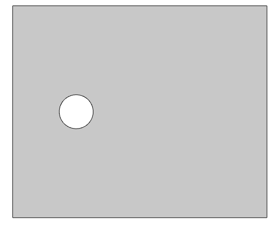
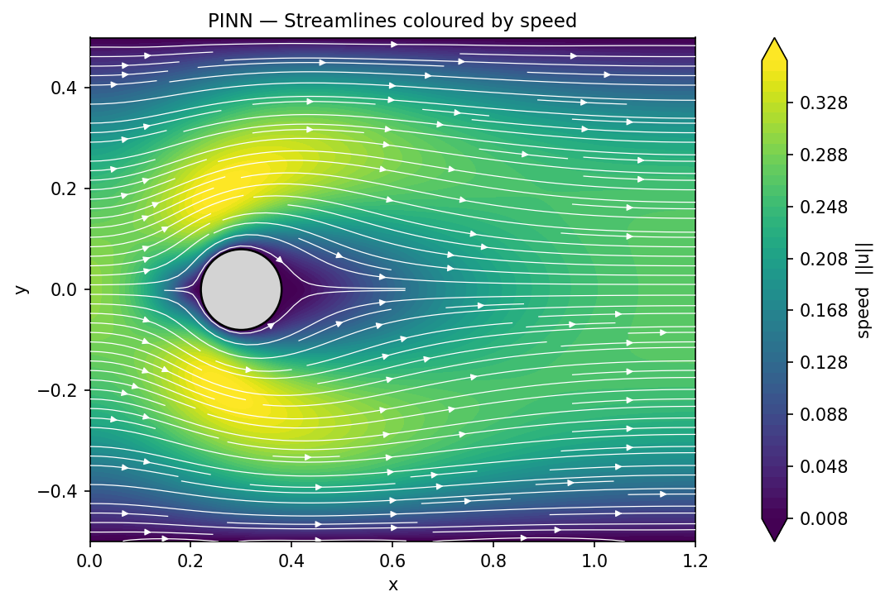
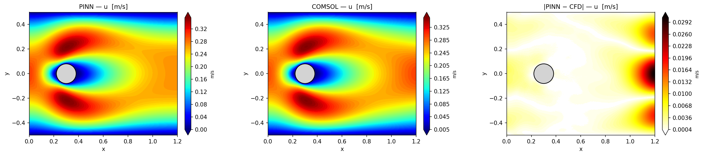
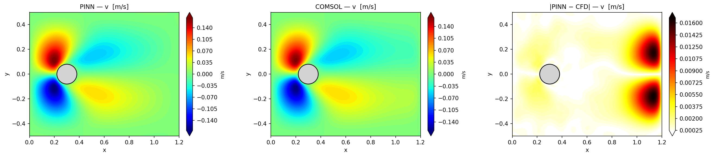
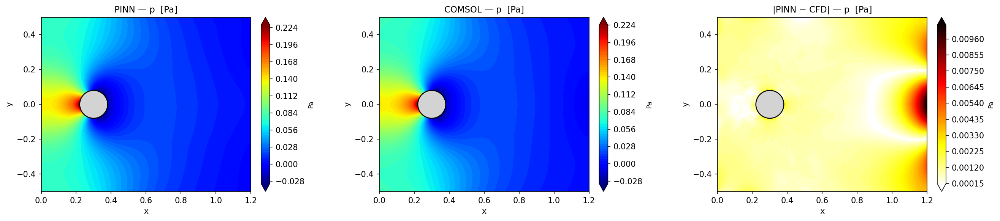

# Physics-Informed Neural Network — 2D Steady Navier-Stokes Flow Past a Cylinder

A **Physics-Informed Neural Network (PINN)** that solves the 2D steady incompressible
Navier-Stokes equations for flow past a circular cylinder, trained entirely without
simulation data by embedding the governing physics directly into the loss function.

---

## Table of Contents

1. [Physical System](#1-physical-system)
2. [Governing Equations](#2-governing-equations)
3. [Boundary Conditions](#3-boundary-conditions)
4. [PINN Methodology](#4-pinn-methodology)
5. [Network Architecture](#5-network-architecture)
6. [Training Strategy](#6-training-strategy)
7. [COMSOL Reference Solution](#7-comsol-reference-solution)
8. [Project Structure](#8-project-structure)
9. [Installation & Usage](#9-installation--usage)
10. [Results](#10-results)

---

## 1. Physical System

The problem models **laminar, steady, incompressible 2D flow** past a circular
cylinder confined inside a rectangular channel.

<p align="center">
  
  <br>
  <em>Computational domain: rectangular channel with circular cylinder obstacle</em>
</p>

| Parameter | Value |
|---|---|
| Domain | $x \in [0,\, 1.2]$, $y \in [-0.5,\, 0.5]$ |
| Cylinder centre | $(0.3,\; 0.0)$ |
| Cylinder radius | $R = 0.08$ |
| Density | $\rho = 1.0\ \text{kg/m}^3$ |
| Dynamic viscosity | $\mu = 0.01\ \text{Pa·s}$ |
| Reynolds number | $Re = \rho U_{\text{avg}} D / \mu \approx 3.2$ |

At these Reynolds numbers the flow is fully laminar.

---

## 2. Governing Equations

The 2D **steady incompressible Navier-Stokes** equations:

**Continuity:**

```math
\frac{\partial u}{\partial x} + \frac{\partial v}{\partial y} = 0
```

**x-momentum:**

```math
u\frac{\partial u}{\partial x} + v\frac{\partial u}{\partial y} + \frac{\partial p}{\partial x} - \nu\left(\frac{\partial^2 u}{\partial x^2} + \frac{\partial^2 u}{\partial y^2}\right) = 0
```

**y-momentum:**

```math
u\frac{\partial v}{\partial x} + v\frac{\partial v}{\partial y} + \frac{\partial p}{\partial y} - \nu\left(\frac{\partial^2 v}{\partial x^2} + \frac{\partial^2 v}{\partial y^2}\right) = 0
```

where $\nu = \mu/\rho$ is the kinematic viscosity and $(u, v, p)$ are the two velocity
components and pressure.
All derivatives are computed exactly via automatic differentiation through the neural
network.

---

## 3. Boundary Conditions

Five boundary segments are enforced during training:

| Boundary | Location | Condition | Description |
|---|---|---|---|
| **Inflow** | $x = 0$ | $u = 0.3(1 - 4y^2),\ v = 0$ | Parabolic velocity profile ($U_{\max} = 0.3$, $U_{\text{avg}} = 0.2$) |
| **Outflow** | $x = 1.2$ | $\bar{p} = 0,\ v = 0$ | Zero mean pressure; no transverse flow |
| **Top wall** | $y = +0.5$ | $u = 0,\ v = 0$ | No-slip |
| **Bottom wall** | $y = -0.5$ | $u = 0,\ v = 0$ | No-slip |
| **Cylinder surface** | $r = R$ | $u = 0,\ v = 0$ | No-slip |

---

## 4. PINN Methodology

A PINN encodes the physics residuals directly into its training loss:

$$\mathcal{L} = w_{\text{pde}}\,\mathcal{L}_{\text{pde}} + w_{\text{bc}}\,\mathcal{L}_{\text{bc}}$$

**PDE loss** — evaluated at randomly sampled *collocation points* inside the fluid domain:

$$\mathcal{L}_{\text{pde}} = \underbrace{\|\mathcal{R}_{\text{cont}}\|^2}_{\text{continuity}} +
                             \underbrace{\|\mathcal{R}_{x\text{-mom}}\|^2}_{x\text{-momentum}} +
                             \underbrace{\|\mathcal{R}_{y\text{-mom}}\|^2}_{y\text{-momentum}}$$

**BC loss** — evaluated on boundary points sampled from each boundary segment:

$$\mathcal{L}_{\text{bc}} = \mathcal{L}_{\text{inflow}} + \mathcal{L}_{\text{outflow}} +
                             \mathcal{L}_{\text{walls}} + \mathcal{L}_{\text{cylinder}}$$

No simulation data is needed. The network learns the flow field purely by minimising
these physics and boundary residuals.

---

## 5. Network Architecture

Fully-connected feedforward network with `tanh` activations and Xavier weight initialisation.

```
Input (2)  →  [50 × 8 hidden layers]  →  Output (3)
  (x, y)        tanh activations           (u, v, p)
```

The inputs are **normalised** before the first layer to map
$x \in [0,\, 1.2] \to [-1,1]$ and $y \in [-0.5,\, 0.5] \to [-1,1]$,
which improves gradient flow through the network.

| Property | Value |
|---|---|
| Architecture | `[2, 50, 50, 50, 50, 50, 50, 50, 50, 3]` |
| Hidden layers | 8 |
| Neurons per layer | 50 |
| Activation | `tanh` |
| Total parameters | ~18,000 |

`tanh` is preferred over ReLU in PINNs because it is infinitely differentiable,
which is convenient for computing second-order partial derivatives via autograd.

---

## 6. Training Strategy

### Optimiser & Scheduler

- **Adam** with initial learning rate $10^{-3}$
- **Cosine annealing** decay down to $4 \times 10^{-6}$ over the full training run
- **Gradient clipping** (max L2 norm = 1.0) to stabilise early training

### Collocation Sampling

Interior points are sampled **uniformly** at random, with all points inside the
cylinder shell rejected. The default count is 30,000 points.

### Adaptive Residual-Guided Resampling

Every `resample_every` epochs a fresh candidate pool is drawn, PDE residuals are
evaluated, and the `resample_add` highest-error candidates are appended to the
collocation set — up to a hard cap of `resample_max` points.

```
Initial             30,000 uniform pts
  ↓  every 1000 epochs
Add top 2,000 highest-residual pts from candidate pool
  ↓
Cap at 45,000 pts total
```

This focuses computational effort on regions where the network is struggling most.

### Early Stopping

Training halts automatically if the total loss does not improve by more than
$10^{-7}$ for 5,000 consecutive epochs.

### Checkpointing

- A checkpoint `checkpoint_epochXXXXXX.pt` is saved every `save_every` epochs.
- `best_model.pt` is overwritten whenever a new lowest loss is achieved.

---

## 7. COMSOL Reference Solution

`eval.py` can optionally compare PINN predictions against a **COMSOL Multiphysics**
finite-element reference solution exported as a plain-text file
(`SolutionCOMSOL.txt`).

**Expected file format** (columns, `%` lines are comments/headers):

```
% x   y   u   v   p   speed
0.01  0.0  0.98  0.0  0.12  0.98
...
```

The COMSOL data is scattered (unstructured FEM mesh), so `eval.py` interpolates
it onto the same regular grid used for PINN prediction using
**linear barycentric interpolation** (`scipy.interpolate.griddata`).

Three error metrics are computed per field:

| Metric | Formula |
|---|---|
| Absolute L2 error | √(mean((Q_PINN − Q_CFD)²)) |
| Relative L2 error | ‖Q_PINN − Q_CFD‖₂ / ‖Q_CFD‖₂ |

---

## 8. Project Structure

```
PINN_NavierStoke/
│
├── model.py             # PINN architecture, NS residuals, loss function
├── sampling.py          # Collocation & BC point generation, adaptive resampling
├── train.py             # Training loop (local GPU/CPU)
├── eval.py              # Evaluation, plotting, COMSOL comparison
├── requirements.txt     # Python dependencies
│
├── models/
│   ├── best_model.pt                  # Best checkpoint (lowest loss)
│   └── checkpoint_epochXXXXXX.pt      # Periodic checkpoints
│
└── images/
    ├── geometry_domain.png            # Domain schematic
    ├── loss_curve.png                 # Total loss curve
    ├── loss_curve_components.png      # PDE vs BC loss curves
    ├── eval_streamlines.png           # Streamlines plot
    ├── comparison_u.png               # u velocity comparison
    ├── comparison_v.png               # v velocity comparison
    └── comparison_p.png               # Pressure comparison
```

---

## 9. Installation & Usage

### Install dependencies

```bash
pip install -r requirements.txt
```

---

### Train locally

```bash
python train.py
```

Edit the `CFG` dictionary at the top of `train.py` to change hyperparameters:

```python
CFG = {
    'layers'      : [2, 50, 50, 50, 50, 50, 50, 50, 50, 3],
    'rho'         : 1.0,
    'mu'          : 0.01,
    'w_pde'       : 1.0,
    'w_bc'        : 10.0,
    'n_uniform'   : 30000,
    'epochs'      : 100000,
    'lr'          : 1e-3,
    ...
}
```

Checkpoints are written to `models/` every `save_every` epochs.


---

### Evaluate a trained model

```bash
# Default: loads models/best_model.pt, displays plots interactively
python eval.py

# Custom checkpoint, save figures to the same folder as the checkpoint
python eval.py --ckpt models/best_model.pt --save

# Higher resolution grid
python eval.py --res 600

# With COMSOL reference for error comparison
python eval.py --ref SolutionCOMSOL.txt --save
```

| Flag | Default | Description |
|---|---|---|
| `--ckpt` | `models/best_model.pt` | Path to checkpoint |
| `--ref` | `SolutionCOMSOL.txt` | COMSOL reference file |
| `--res` | `400` | Grid resolution (N×N points) |
| `--save` | off | Save figures as PNG instead of showing interactively |
| `--device` | auto | `cuda` / `cpu` |

---

## 10. Results

### Loss Curves

Training is monitored with three loss signals saved at the end of each run:

**Total loss** (log scale):

.png)

The steep initial descent reflects the network quickly learning the dominant flow
features (inflow profile, pressure gradient). The slower tail corresponds to the
network refining the boundary layers near the cylinder and channel walls, where
gradients are steepest.

**PDE residual vs. BC loss** (log scale):

.png)

The BC loss typically converges faster because it is a simpler, pointwise
constraint. The PDE loss decays more slowly as it requires the network to
satisfy differential equations throughout the entire fluid domain simultaneously.
The gap between the two at any epoch reflects the tension between fitting
boundaries and enforcing physics, controlled by the `w_pde` / `w_bc` weights.

---

### Flow Field Predictions

After running `python eval.py --save`, the following figures are produced in the
checkpoint folder:

---

#### Streamlines coloured by speed  (`eval_streamlines.png`)



This plot overlays white streamlines on a speed magnitude
$\|\mathbf{u}\| = \sqrt{u^2 + v^2}$ colour map. Key features to look for:

- **Stagnation point** at the front of the cylinder ($x \approx 0.22$) — speed
  drops to near zero, pressure reaches its maximum.
- **Acceleration** around the cylinder flanks — the flow squeezes through the
  gap between the cylinder and the walls, increasing speed.
- **Recovery** downstream — velocity gradually returns to the channel profile.

---

#### Velocity component $u$  (`comparison_u.png`)



The $u$ field shows the streamwise velocity. The region with the highest
output error is typically near the outflow boundary. This is expected because
small upstream inaccuracies can accumulate as they are convected downstream,
and the outlet uses a weak pressure-gauge condition rather than a fully
prescribed velocity profile. Even so, this is still a low-error region in
absolute terms, and the overall agreement with the reference solution remains
very good.

---

#### Velocity component $v$  (`comparison_v.png`)



The $v$ (cross-stream) component is antisymmetric about $y=0$ for steady flow.
The PINN must learn this symmetry implicitly from the loss, no symmetry is
explicitly enforced.

---

#### Pressure field  (`comparison_p.png`)



Pressure is the most challenging output to learn. Key features:
- High-pressure stagnation region* at the front of the cylinder.
- Low-pressure wake immediately behind, the pressure difference across the
  cylinder drives the drag force.
- The PINN has no explicit pressure boundary condition (only $\bar{p}=0$ at
  the outlet as a gauge fix); the entire pressure field must emerge from the
  momentum equations.

---

## References

- Sun, Y., Sengupta, U., & Juniper, M. (2023). **Physics-informed deep learning for 
  simultaneous surrogate modeling and PDE-constrained optimization of an airfoil geometry.**
  Department of Engineering, University of Cambridge. Available online 14 April 2023.
- Raissi, M., Perdikaris, P., & Karniadakis, G. E. (2022). **Physics-informed neural 
  networks (PINNs).**
  arXiv preprint arXiv:2201.05624. https://arxiv.org/abs/2201.05624
